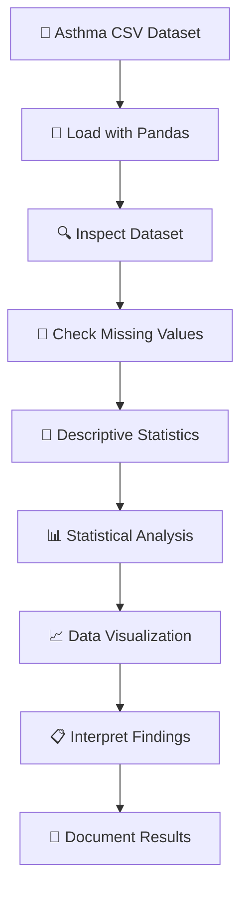

# 🫁 Asthma Data Analysis | Healthcare Data Science Project

<p align="center">
  
  
  
  
  
  
</p>

## 📌 Project Overview

The **Asthma Data Analysis** project explores asthma-related healthcare statistics using Python and exploratory data analysis (EDA).

The project uses a structured CSV dataset containing asthma prevalence estimates, age categories, year information, standard errors, and other statistical indicators. Using Pandas, NumPy, Matplotlib, and Seaborn, the notebook examines the dataset, generates descriptive statistics, and visualises asthma-related estimates across demographic categories.

The primary objective is to understand how healthcare data can be processed, explored, and visualised to support statistical interpretation and data-driven research.

**Project Domain:** Healthcare Analytics, Data Science, Exploratory Data Analysis

---

## 🎯 Project Objectives

- 🫁 Explore asthma-related healthcare statistics.
- 📁 Load and process structured healthcare data.
- 🔍 Inspect dataset structure and data types.
- 🧹 Identify missing values and data-quality issues.
- 🧮 Generate descriptive statistical summaries.
- 📊 Explore asthma prevalence estimates.
- 📈 Visualise statistical distributions across age categories.
- 📋 Develop practical skills in Python-based healthcare data analysis.

---

## ✨ Key Features

| Feature | Description |
|---|---|
| 📥 Dataset Loading | Reads asthma-related CSV data using Pandas. |
| 🔍 Data Inspection | Examines records, variables, and data types. |
| 🧹 Missing Data Analysis | Identifies incomplete statistical estimates. |
| 🧮 Descriptive Statistics | Calculates mean, median, standard deviation, and other summaries. |
| 📊 Statistical Visualisation | Uses Matplotlib and Seaborn for graphical analysis. |
| 🫁 Healthcare Data Exploration | Examines asthma-related prevalence estimates. |
| 📈 Age-Group Exploration | Visualises estimates in relation to age categories. |
| 📓 Interactive Analysis | Performs analysis in a Jupyter Notebook. |

---

## 🛠️ Technologies and Libraries

- 🐍 **Python** — Main programming language.
- 🐼 **Pandas** — Dataset loading, manipulation, and analysis.
- 🔢 **NumPy** — Numerical operations.
- 📊 **Matplotlib** — Data visualisation.
- 🎨 **Seaborn** — Statistical graphics.
- 📓 **Jupyter Notebook** — Interactive development and analysis.

---

## 📊 Dataset Overview

The project uses `Asthma.csv`.

The notebook reports the following dataset characteristics:

| Attribute | Description |
|---|---:|
| Total Records | 1,300 |
| Total Variables | 22 |
| Non-Missing Estimates | 1,048 |
| Missing Estimates | 252 |
| Year Coverage | 1997–2022 |
| Main Statistical Measure | Asthma prevalence estimate |

### Important Dataset Variables

| Variable | Description |
|---|---|
| `YEAR` | Statistical observation year |
| `AGE` | Age category |
| `INDICATOR` | Healthcare indicator |
| `PANEL` | Asthma-related statistical panel |
| `UNIT` | Measurement unit |
| `ESTIMATE` | Estimated prevalence value |
| `SE` | Standard error |
| `FLAG` | Statistical status or flag |
| `FOOTNOTE_LIST` | Associated explanatory footnotes |

The dataset includes aggregate statistical observations. These records represent population-level estimates, not individual patient diagnoses.

---

## 🔍 Exploratory Data Analysis

### 1. 📥 Data Loading

The dataset is loaded using Pandas:

```python
import pandas as pd

data = pd.read_csv("Asthma.csv")

print(data.head())
```

This provides an initial overview of the available observations.

### 2. 🔍 Dataset Inspection

```python
data.info()
```

The inspection identifies:

- Number of records.
- Number of columns.
- Data types.
- Non-null values.
- Missing values.
- Memory usage.

### 3. 🧮 Descriptive Statistical Analysis

```python
data.describe()
```

This calculates:

- Count.
- Mean.
- Standard deviation.
- Minimum and maximum.
- Quartiles.
- Median.

### 4. 📊 Statistical Visualisation

The notebook uses Seaborn to create a box plot:

```python
import matplotlib.pyplot as plt
import seaborn as sns

plt.figure(figsize=(10, 5))

sns.boxplot(
    x=data["ESTIMATE"],
    y=data["AGE"]
)

plt.title("Asthma Prevalence Estimates by Age Category")
plt.xlabel("Asthma Estimate (%)")
plt.ylabel("Age Category")

plt.show()
```

This visualisation explores the distribution of prevalence estimates across age categories.

---

## 📈 Analysis Results

The notebook reports the following descriptive statistics:

| Metric | Result |
|---|---:|
| Total Records | 1,300 |
| Dataset Variables | 22 |
| Available Estimates | 1,048 |
| Missing Estimates | 252 |
| Mean Estimate | 6.73 |
| Median Estimate | 6.00 |
| Minimum Estimate | 0.50 |
| Maximum Estimate | 17.00 |
| Standard Deviation | 2.86 |

**Interpretation:** These are descriptive statistics across the available dataset records. They should not be interpreted as a single overall asthma prevalence rate or as individual-level medical predictions.

---

## 🔄 Project Workflow

1. 📁 Obtain the asthma-related dataset.
2. 📥 Load the CSV file using Pandas.
3. 🔍 Inspect the data structure.
4. 🧹 Identify missing values and data-quality issues.
5. 🧮 Generate descriptive statistics.
6. 📊 Explore asthma prevalence estimates.
7. 📈 Generate statistical visualisations.
8. 📋 Interpret and document the findings.

### Workflow Diagram



---

## 📂 Project Structure

```text
Asthma_ML/
│
├── Asthma.csv
├── sample.ipynb
├── my_plot.png
├── .gitignore
└── README.md
```

---

## 🚀 Installation and Setup

### 1. Clone the Repository

```bash
git clone https://github.com/roshanksah/Asthma_ML.git
```

### 2. Navigate to the Project

```bash
cd Asthma_ML
```

### 3. Install Dependencies

```bash
pip install pandas numpy matplotlib seaborn jupyter
```

### 4. Launch Jupyter Notebook

```bash
jupyter notebook
```

### 5. Open the Notebook

Open `sample.ipynb` and execute the cells to reproduce the analysis.

---

## 🏆 Project Outcomes

This project demonstrates:

- ✅ Loading and manipulating healthcare datasets.
- ✅ Inspecting structured statistical data.
- ✅ Identifying missing values.
- ✅ Performing descriptive statistical analysis.
- ✅ Exploring asthma prevalence estimates.
- ✅ Creating statistical visualisations.
- ✅ Using Python for healthcare data exploration.
- ✅ Communicating findings from structured data.

---

## ⚠️ Limitations

- The current repository demonstrates exploratory data analysis, not a completed ML prediction pipeline.
- The dataset contains aggregate statistics rather than individual patient records.
- Some statistical estimates are missing.
- Descriptive statistics alone cannot establish causal relationships.
- The project is not a clinical diagnostic or medical decision-support system.
- No model accuracy or prediction-performance metrics are claimed.

---

## 🔮 Future Enhancements

- 📈 Develop additional visualisations for year-wise prevalence trends.
- 🧹 Improve missing-value analysis and data cleaning.
- 📊 Explore age-group and population-level comparisons.
- 📐 Include uncertainty intervals using standard errors.
- 🧪 Add statistical hypothesis testing where appropriate.
- 🧠 Extend the project using a suitable individual-level, labelled dataset for a properly designed ML experiment.
- 📋 Evaluate any future model using cross-validation and appropriate classification metrics.
- 📖 Improve documentation and reproducibility.

---

## 👨‍💻 Author

**Roshan Kumar Sah**

🎓 BSc (Hons) Computer Systems Engineering  
🏫 University of Sunderland (UK) — delivered through ISMT College, Nepal

🔗 GitHub: https://github.com/roshanksah

---

## ⭐ Acknowledgement

This project represents my exploration of healthcare data analytics and Python-based statistical analysis. It helped me develop practical experience in data processing, exploratory data analysis, descriptive statistics, and visualisation of health-related information.

Thank you for exploring this project! ⭐
